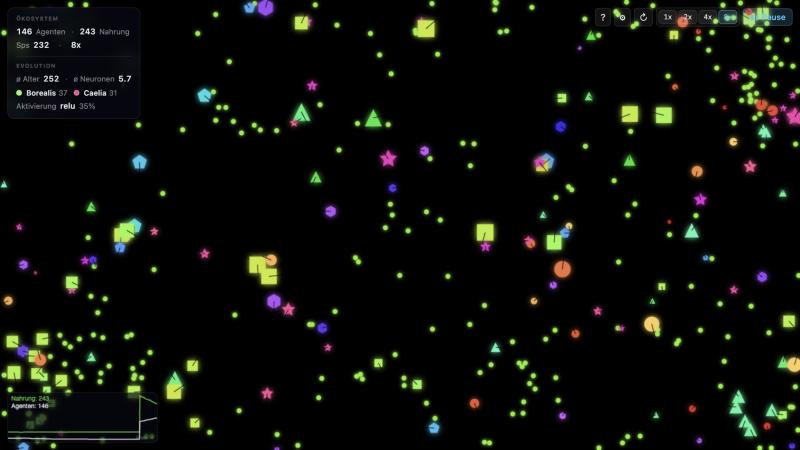

# EvoSim — neuroevolution in the browser

Agents with small neural-network brains move through a toroidal world, eat, reproduce and die. Their genome encodes body shape, colour, network size and activation function, and the mutation strength evolves with them, so you can watch species appear, compete and die out in real time.



## What's inside

- **Evolving brains:** the genome sets the hidden-layer size (1–10 neurons) and its activation function (tanh, ReLU or sigmoid). The output layer always uses tanh, because turning and thrust must stay in [-1, 1].
- **Self-adaptive mutation:** the mutation step size is part of the genome and mutates log-normally.
- **Learning within a lifetime:** Hebbian plasticity adjusts a separate set of weights while an agent lives. Children inherit only the genome, never what the parent learned (non-Lamarckian).
- **Sensors:** sector sensors report near and far food and other agents in each direction, plus the agent's own energy and a noise input. The world wraps around at the edges.
- **Species and controls:** species follow from the shape gene, and a live graph tracks population and food. Sliders change food supply, hazards, sensor range and the reproduction threshold while the simulation runs.

## Run it

There is no build step and there are no dependencies. Serve the folder over HTTP, because ES modules don't load from `file://`:

```bash
python3 -m http.server 8032
# open http://localhost:8032
```

Or with Docker (nginx, with a `/health` endpoint):

```bash
docker compose up --build
# open http://localhost:8032
```

## Code map

| File | Role |
|---|---|
| `src/ui.js` | Main loop, HUD, parameter panel, speed controls |
| `src/simulation.js` | Population setup and food spawning |
| `src/agent.js` | Per-tick behaviour: sense, think, move, eat, learn, reproduce |
| `src/neural.js` | Feed-forward network with Hebbian plasticity |
| `src/genome.js` | Genes, mutation, species colours and names |
| `src/state.js` | The single shared state object |
| `src/config.js` | Constants |
| `src/graph.js`, `src/render.js` | Population graph and canvas rendering |

The interface text is in German.
